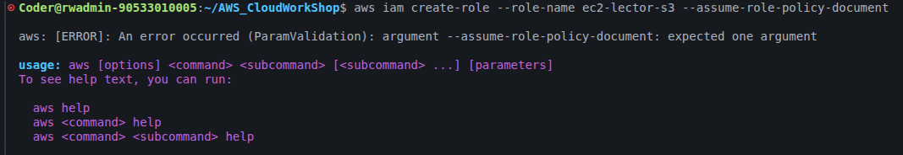
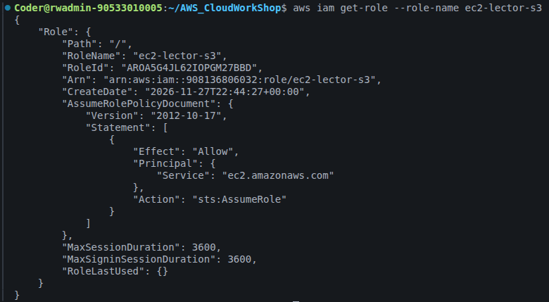
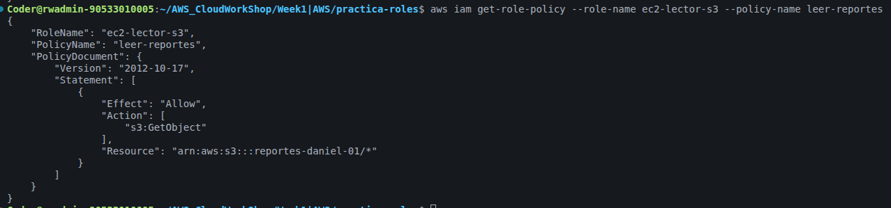
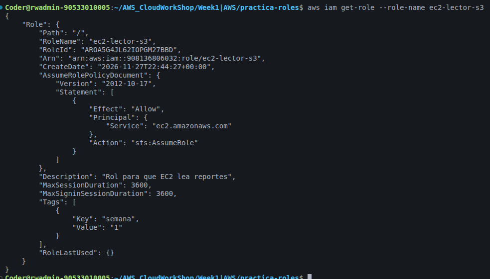
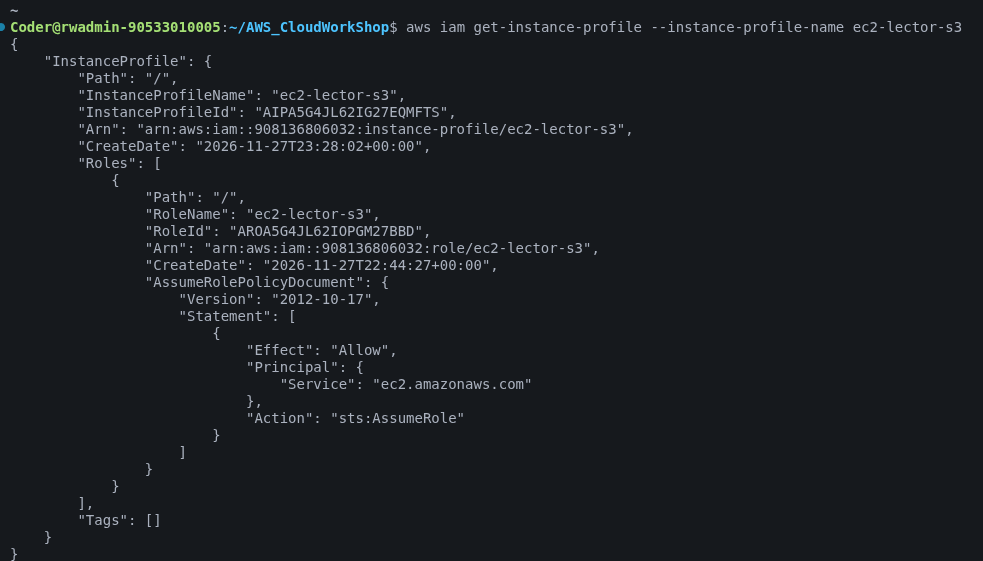
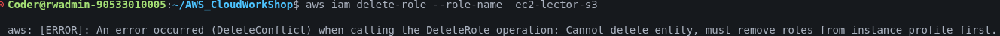

## Parte 3: Crear el rol

Intenta crear el rol `ec2-lector-s3` sin indicar la política de confianza y lee el error.

Muestra los datos del rol y anota su ARN.

**ARN:** `arn:aws:iam::908136806032:role/ec2-lector-s3`

---

## Parte 4: Dar permisos

Muestra el contenido de la política `leer-reportes` desde AWS.

---

## Parte 5: Editar

Muestra los datos del rol y sus etiquetas para verificar los cambios.

---

## Parte 6: Perfil de instancia

Muestra el perfil y confirma que contiene el rol.

---

## Parte 7: Comprobar las reglas de IAM

Intenta borrar el rol con `aws iam delete-role` y lee el error.

---

## Preguntas de reflexión

**1. ¿Qué diferencia hay entre la política de confianza y la política de permisos? ¿Qué pasaría si el rol tuviera solo una de las dos?**
> **R//** La política de confianza permite definir quién puede asumir el rol y es obligatoria para que este exista, mientras que la política de permisos indica qué acciones está autorizado a realizar dicho rol. Si solo tuviera la política de confianza, el rol no podría hacer nada, ya que por defecto viene sin ningún permiso asignado.

**2. ¿Por qué es más seguro que la instancia use un rol en vez de guardar una llave de acceso con `aws configure`?**
> **R//** Porque de esta manera te aseguras de que tu perfil de instancia utilice credenciales temporales con un tiempo de expiración predeterminado, en vez de una llave estática que permite el acceso en cualquier momento sin expiración y es más vulnerable a robos.

**3. Con la política `leer-reportes`, ¿la instancia podrá listar el contenido del bucket? ¿Y borrar `reporte.txt`? Explica por qué.**
> **R//** Con la política `leer-reportes` estás usando únicamente el permiso `s3:GetObject` en el JSON, el cual solo te permite leer los objetos dentro del bucket, mas no listar su contenido (`s3:ListBucket`) ni eliminar archivos (`s3:DeleteObject`).

**4. En el error del paso 20, ¿qué le falta por hacer antes de poder borrar el rol?**
> **R//** El error que sale es `DeleteConflict`, dado que es necesario seguir los siguientes pasos antes de poder borrar el rol:
> - Sacar el rol del perfil de instancia y borrar el perfil.
> - Borrar o desvincular todas las políticas adjuntas al rol.
> - Finalmente, eliminar el rol por completo.

**5. Si mañana la instancia también necesita subir archivos al bucket, ¿qué cambiarías y en cuál de los dos archivos?**
> **R//** Si el día de mañana quisiera que el perfil pueda subir archivos al bucket, editaría la política actual o le añadiría una nueva con permisos para subir objetos (`s3:PutObject`). Para esto, modificaría el archivo JSON de la política de permisos.