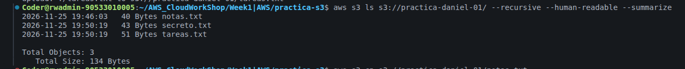
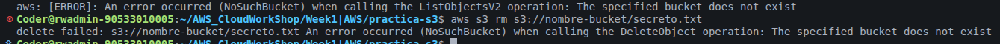

Parte 1: Crear
Consulta en qué región quedó tu bucket.

Parte 2: Subir
Lista el contenido del bucket con tamaños legibles y el total.

Parte 4: Editar
Muestra el contenido de notas.txt desde el bucket y verifica el cambio.

Parte 5: Compartir sin hacerlo público
Espera a que expire y vuelve a abrirlo.

Parte 6: Menor privilegio
Con ese perfil, muestra el contenido de notas.txt.

Con ese perfil, intenta listar el contenido del bucket.

Con ese perfil, intenta borrar secreto.txt.

