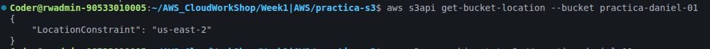
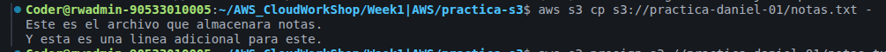
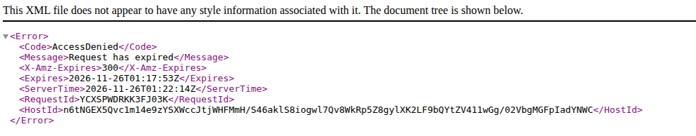
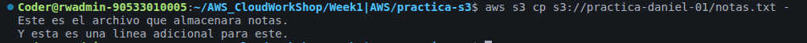
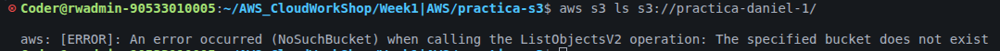
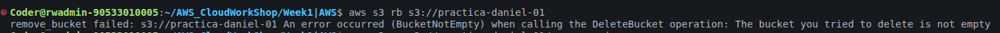
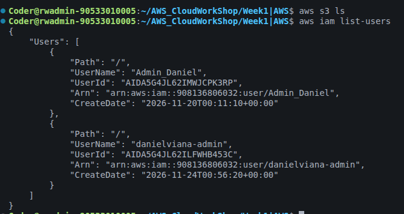

# Práctica de Laboratorio: Gestión y Seguridad en Amazon S3

## Parte 1: Crear
**Consulta en qué región quedó tu bucket.**

---

## Parte 2: Subir
**Lista el contenido del bucket con tamaños legibles y el total.**

---

## Parte 4: Editar
**Muestra el contenido de `notas.txt` desde el bucket y verifica el cambio.**

---

## Parte 5: Compartir sin hacerlo público
**Espera a que expire y vuelve a abrirlo.**

---

## Parte 6: Menor privilegio
**Con ese perfil, muestra el contenido de `notas.txt`.**

**Con ese perfil, intenta listar el contenido del bucket.**

**Con ese perfil, intenta borrar `secreto.txt`.**

---

## Parte 7: Eliminar
**Intenta borrar el bucket sin vaciarlo y lee el error.**

**Lista los buckets y los usuarios y confirma que no quedó nada de la actividad.**

---

## Preguntas de reflexión

1. **¿Por qué el nombre de tu bucket tuvo que ser distinto al de tus compañeros si cada uno tiene su propia cuenta?**
   > **R//** Porque Amazon s3 utiliza un espacio global comparido entre todas las cuentas AWS del mundo, por lo que no pueden existir dos buckets con el mismo nombre a nivel mundial.

2. **El usuario del paso 21 pudo leer un archivo, pero en el paso 22 no pudo ver la lista. ¿Qué acción le faltaba en la política?**
   > **R//** Le faltaba la acción de `s3:ListBucket`; por el momento, como se puede ver en el JSON, nada más tenía permitido el de `s3:GetObject`.

3. **En la política, ¿qué significa el `/*` al final del Resource? ¿Qué pasaría si se quitara?**
   > **R//** El /* indica que el permiso aplica a todos los objetos dentro del bucket. Si se quitara, el ARN apuntaria solo al contenedor (bucket) y acciones de objeto como s3:GetObject fallarian con acceso denegado, obligandote a especificar rutas exactas de cada archivo. ej. arn:aws:s3:::mi-bucket/notas.txt
   

4. **¿En qué se diferencia compartir un archivo con un enlace temporal de hacer público el bucket?**
   > **R//** Se diferencia en que este enlace temporal se rige bajo un tiempo estimado unicamente un archivo especifico, mediante una firma con tus credenciales, mientras el bucket sigue privado; En cambio, hacerlo publico el bucket se expondria permanentemente su contenido sin autenticacion publicamente.

5. **Según el modelo de responsabilidad compartida, si alguien deja un bucket público con datos de clientes, ¿de quién es la responsabilidad?**
   > **R//** Del propio desarrollador; AWS se encarga de proveerte con la infraestructura necesaria, uno como desarrollador tiene la responsabilidad de configurarla de tal manera para no tener brechas de seguridad.